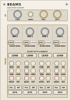

# Grandsummoner Beams

> **18 HP Quad Algorithmic Euclidean Drum Engine & Sampler**

<p align="center">
  
</p>

---

## Overview

**Beams** is an 18 HP four-track algorithmic drum sampler and Euclidean rhythm generator for [VCV Rack v2](https://vcvrack.com/). Designed as the rhythmic foundation of the Grandsummoner module family, Beams pairs internal multi-layer acoustic and synthetic drum sound engines with Euclidean pattern generators across four dedicated channels: **Kick**, **Snare**, **Hi-Hat**, and **Percussion**.

Every track features dedicated Euclidean length, hit count, and rotation controls, pitch tuning, decay envelopes, and dual round-robin sample modes. With its built-in wide-range master clock (5–400 BPM) and external clock sync, Beams can drive entire modular patches or slave seamlessly to master clock networks.

---

## The Grandsummoner Module Family

Beams is the rhythmic engine of the **Grandsummoner Eurorack Family**, designed to integrate into a cohesive modular synthesis ecosystem:

| Module | Width | Primary Function | Role in Ecosystem |
| :--- | :--- | :--- | :--- |
| **Spaces Command** | 38 HP | Dual-Scene Probabilistic CV/Gate Sequencer & Arpeggiator | Master Composition & Clock Brain |
| **Beams** | 18 HP | Quad Algorithmic Euclidean Drum Engine & Sampler | Rhythm, Percussion & Clock Sync |
| **Stellar** | 14 HP | Dual-Voice Multi-Model Synthesizer Companion | Primary Melodic & Harmonic Voice |
| **Intel** | 14 HP | Modulation Matrix, Dual FX Engine & Metering Ladder | Utility, Inter-Module Modulation & Modulation Router |
| **Explorer** | 12 HP | Tape-Cloud Delay, Diffusion Reverb & Octave Shimmer | Master Spatialization, Diffusion & Ambient Textures |

### Shared Design Language
Every Grandsummoner module adheres to a unified visual and tactile standard:
- **Warm Sand Cards** (`#F5F1E9` down to `#EDE7DC`) framed by precision `0.4–0.5pt` bronze perimeter cards (`#8A7F6A`).
- **Deep Obsidian Knobs** with ivory indicator indices (`#E8E0D0`).
- **Tactile Performance Buttons**: Navy/Teal (`#2E4A6E`) for round-robin mode switching, Maroon (`#8A2A2A`) for performance muting.
- **Center-Detent Indicators** on bipolar pitch controls (`TUNE`).

### Standalone vs. Family Operation
- **100% Standalone**: Beams requires no other modules to produce full rhythmic arrangements. Patch external clocks into `CLOCK`, trigger tracks externally via `TRIG 1–4`, or let Beams run freely using its internal 5–400 BPM clock generator.
- **Universal Adjacency Link**: Side connector LEDs (`LINK L` and `LINK R`) illuminate whenever Beams is adjacent to any Grandsummoner family module (**Spaces Command**, **Intel**, **Stellar**, or **Explorer**).

### Cross-Module Synergies
- **With Intel (Bidirectional Expander Bus)**:
  - **Clock Distribution**: When Beams is adjacent to Intel, Beams automatically publishes high-resolution clock ticks (`beamsTick`) across the expander boundary. Intel locks its 4 LFO trigger outputs (`TRIG 1–4`) directly to Beams' Euclidean grid.
  - **Global Decay Offset**: Intel's `TONE` knob simultaneously acts as a macro decay control for Beams, letting you tighten or lengthen all drum voices with a single knob.
- **With Spaces Command**: Patch Beams' master clock into Spaces Command's `CLOCK` input to keep melody and drums locked in phase across complex scene morphs.
- **With Stellar**: Send Beams' Kick trigger to sidechain Stellar's `MOD 1/2` inputs for instant ducking/pumping synthesis basslines.
- **With Explorer**: Send Beams' `MASTER L/R` outputs into Explorer's tape delay for stereo dub-echo drum fills.

---

## User Guide & Controls
### 1. Global Clock & Master Section (Top Card)
- **TEMPO (5 – 400 BPM)**: Sets internal master clock frequency when `CLOCK` is unpatched. Protected against accidental patch randomization.
- **CLOCK Input**: Standard Eurorack clock/trigger input (threshold +1.5V). When patched, overrides internal tempo and slaves the engine.
- **MASTER L / MASTER R**: Stereo audio outputs with internal dynamic soft-limiting to prevent digital clipping across hot drum layers.

### 2. Per-Track Sound & Sequencing Controls (Tracks 1–4)
Each of the 4 tracks provides independent sonic and Euclidean parameters:
- **LEVEL (0% – 100%)**: Output volume of the track within the internal master mix.
- **TUNE (Bipolar: -12 to +12 Semitones)**: Center-detented pitch control for tuning kicks to the song's root key or pitching percussion up/down.
- **DECAY (10 ms – 2.5 s)**: Amplitude envelope decay time. Modulated additively by Intel when expander linked.
- **LEN (1 – 32 Steps)**: Euclidean sequence pattern length. Defaults to 16 steps.
- **STEPS (0 – 32 Hits)**: Number of active hits distributed evenly across the pattern length using Bjorklund's Euclidean algorithm.
- **ROT (0 – 31 Rotation)**: Shifts the starting step of the Euclidean pattern forward in time.
- **RR MODE Button (Navy/Teal `#2E4A6E`)**: Toggles Round-Robin sample cycling between **Sequential** (reproducible cyclic variations) and **Random** (organic humanization).
- **FILL Button**: Momentarily floods the pattern with high-density fill steps for live build-ups and transitions.
- **INV Button (Inverse Fill)**: Inverts pattern logic, triggering hits on steps that are normally rests.
- **MUTE Button (Maroon `#8A2A2A`)**: Silences audio output for the track while the underlying Euclidean sequencer continues running in phase.
- **TRIG Input**: External gate/trigger jack for triggering the voice manually from sequencers, MIDI-CV interfaces, or clock dividers.

---

## Technical Specifications

- **Width**: 18 HP (91.44 mm)
- **Height**: 3U (128.5 mm physical standard / bit-for-bit 380px VCV grid height)
- **Depth**: 28 mm
- **Voices**: 4 simultaneous polyphonic sample-playback channels
- **Euclidean Resolution**: 1 to 32 steps per track with independent rotation
- **Tempo Range**: 5.0 to 400.0 BPM (internal clock generator)
- **Internal DSP**: 32-bit floating point with anti-aliased sinc interpolation
- **Output Level**: Standard modular Eurorack audio (±5V / 10Vpp)

---

## Building and Installation

### Prebuilt Plugin Package
Download the latest `Beams-2.0.0-<platform>.vcvplugin` from the [Releases](https://github.com/Grandsummoner/beams/releases) section and copy it to your VCV Rack `plugins` directory:
- **Windows**: `Documents/Rack2/plugins/`
- **macOS**: `Documents/Rack2/plugins/`
- **Linux**: `~/.Rack2/plugins/`

### Building from Source
Ensure you have the [VCV Rack SDK v2](https://vcvrack.com/downloads/) installed.

```bash
# Clone the repository
git clone https://github.com/Grandsummoner/beams.git
cd beams

# Set your Rack SDK directory
export RACK_DIR=/path/to/Rack-SDK

# Build the distributable package
make -j2 dist
